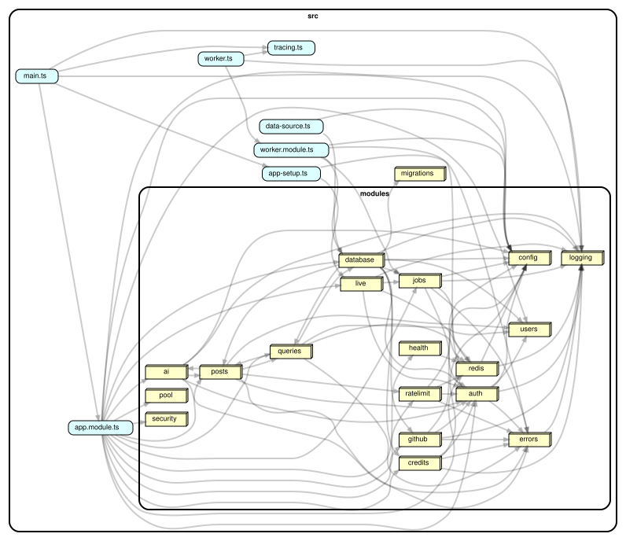

# devhub: навчальний backend

Один застосунок на NestJS 11, один PostgreSQL 16, один Redis 7. Кожна базова річ бекенду (валідація, транзакції, індекси, локи, черги, WebSocket, ліміти, LLM) живе в окремому маленькому модулі з поясненням. Мета: навчити, а не вразити. Без мікросервісів, без DDD-шарів, без монорепо.

Домен: користувачі, пости (теги, статус, м'яке видалення, вектор), кредити з резерваціями, імпорт репозиторіїв з GitHub, довгі звіти в черзі, високочастотні події, жива дошка.

## Запуск

Потрібні Node 22 і запущений Docker Desktop.

```
npm run up
```

Далі відкрити:

- http://localhost:5173: learn, сторінка на кожну тему, починати звідси
- http://localhost:8080/reference: контракт API
- http://localhost:8080/queues: черги
- http://localhost:16686: Jaeger

Із Grafana і Prometheus: `npm run up -- --observability` (Grafana на http://localhost:3001, admin/admin).

Зупинити: `npm run down`. Разом з даними: `npm run down -- --wipe`.

<details>
<summary>Що робить npm run up і що робити, якщо щось пішло не так</summary>

Ставить npm-залежності, якщо їх немає, створює `.env`, гасить інший проєкт `backend-*`, якщо він зараз працює (усі три ділять порти 5432, 6379, 16686), перевіряє, чи вільні порти, піднімає все через docker compose, чекає, поки сервіси стануть healthy, робить перевірочні запити і друкує адреси.

Якщо порт тримає щось поза Docker (локальний Postgres або Redis), скрипт назве порт і зупиниться: зупини ту програму і повтори. Якщо якийсь сервіс упав, скрипт надрукує його логи; повний лог: `docker compose logs <сервіс>`.

</details>

## Запуск без Docker

Потрібні Node 22, PostgreSQL 16 (для similar-пошуку з розширенням pgvector), Redis 7.

```
cp .env.example .env        # впиши DATABASE_URL, JWT_SECRET, REDIS_URL
npm install
npm run migration:run
npm run seed
npm run dev                  # API на :3000
npm run dev:worker           # воркер, окремий термінал
scripts/smoke.sh             # прохід по всіх ендпоінтах
```

## Карта модулів

Порядок навчальний, той самий, що в лівому меню `learn/` і в посиланнях "Попередня тема / Наступна тема" внизу кожного документа в `docs/`. Один рядок = одна сторінка learn.

| # | Тема | Модулі в коді | Що показує | Docs |
|---|---|---|---|---|
| 1 | Старт | auth | реєстрація і логін, JWT 15 хв, refresh з ротацією і виявленням крадіжки, ролі | [auth](docs/modules/auth.md) |
| 2 | Конфіг і формат помилок | config, errors | env через zod і падіння на старті з ясним текстом; одна форма помилки, таблиця кодів 400..502 | [config](docs/modules/config.md), [errors](docs/modules/errors.md) |
| 3 | Пагінація, сортування, фільтри | posts | вкладена валідація, фільтри, offset і cursor, транзакція publish | [posts](docs/modules/posts.md) |
| 4 | Міграції, час, soft delete | migrations, time, posts | міграції замість synchronize, revert індексу, timestamptz і UTC-сесія, DELETE і restore поста | [migrations](docs/modules/migrations.md), [time](docs/modules/time.md), [posts](docs/modules/posts.md) |
| 5 | SQL, N+1 і індекси | queries | сирий SQL з віконною функцією, N+1 з лічильником запитів, EXPLAIN до і після індексу | [queries](docs/modules/queries.md) |
| 6 | Кеш | queries | кеш у Redis, X-Cache HIT/MISS, інвалідація при PATCH | [queries](docs/modules/queries.md) |
| 7 | Логи, request-id і health | logging, health | X-Request-Id, JSON-логер, той самий requestId у воркері, GET /health по кожній залежності | [logging](docs/modules/logging.md), [health](docs/modules/health.md) |
| 8 | Тести і CI | test/, .github/workflows | unit / int / e2e, що підміняємо на кожному рівні, кроки CI, завдання "напиши сам" | [testing](docs/testing.md) |
| 9 | Кредити і локи | credits | SELECT FOR UPDATE, 20 паралельних резервацій, CHECK, крон | [credits](docs/modules/credits.md) |
| 10 | Черга і воркер | jobs | BullMQ, окремий воркер, 202 + SSE, retry, backpressure, батчинг x47 | [jobs](docs/modules/jobs.md) |
| 11 | Живе: polling, SSE, WebSocket | live | socket.io, presence, дошка, Redis-адаптер на двох інстансах | [live](docs/modules/live.md) |
| 12 | Пул з'єднань | pool | чому запити 11-20 чекають, три помилки з пулом | [pool](docs/modules/pool.md) |
| 13 | Rate limit | ratelimit | token bucket на Lua, порівняння з throttler | [ratelimit](docs/modules/ratelimit.md) |
| 14 | Безпека | security | helmet, CORS, bcrypt, демо SQL-ін'єкції | [security](docs/modules/security.md) |
| 15 | Метрики, трейси, graceful shutdown | metrics, tracing.ts, shutdown | prom-client і GET /metrics, Prometheus і Grafana, OpenTelemetry і Jaeger, SIGTERM: дочекатись job, закрити пул і Redis | [observability](docs/observability.md), [tracing](docs/tracing.md), [shutdown](docs/modules/shutdown.md) |
| 16 | Зовнішнє API (GitHub) | github | семафор, бюджети, retry по Retry-After | [github](docs/modules/github.md) |
| 17 | AI: LLM і вектори | ai | структурований вихід LLM через zod, pgvector similar | [ai](docs/modules/ai.md) |
| 18 | Деплой | deploy.yml, docker-compose.yml | GitHub Actions після зеленого CI, ssh і docker compose up на VPS або EC2 | [deploy](docs/deploy.md) |

Усі ендпоінти: [docs/ENDPOINTS.md](docs/ENDPOINTS.md). Готові запити: `requests.http`. Трейсинг (OpenTelemetry, Jaeger): [docs/tracing.md](docs/tracing.md). Метрики і логи (Prometheus, Loki, Grafana): [docs/observability.md](docs/observability.md).

## Карта залежностей



Кожен вузол це каталог `src/modules/<name>` (або окремий файл верхнього рівня), стрілка `A -> B` означає "файли з A імпортують щось із B": у кого найбільше вхідних стрілок (`config`, `logging`, `errors`, `auth`), той спільна основа, у кого лише вихідні (`main.ts`, `worker.ts`), той точка входу. Повний граф по файлах: [docs/graphs/files.svg](docs/graphs/files.svg); перегенерувати обидва: `npm run graph` і `npm run graph:files` (потрібен Graphviz, команда `dot` у PATH), перевірити правила (без циклів, `src` не імпортує `test`): `npm run deps:check`.

Довідка по коду (Compodoc): `npm run docs:code`, потім відкрити `docs/compodoc/index.html` у браузері. Сторінка "Modules" показує для кожного Nest-модуля його controllers, providers і imports, тобто те, що `@Module({...})` збирає докупи, і з чого складається граф вище.

## Схема і PDF

- `docs/architecture.excalidraw`: схема проєкту. Показана на першій сторінці learn ("Схема проєкту", тільки перегляд); відкрити для редагування на excalidraw.com через Open або в розширенні Excalidraw у VS Code.
- `docs/Backend_without_panic.pdf`: короткий документ на всі три проєкти: для кожної теми що це, чому важливо, коли про це думати, коли можна забити, при якому трафіку і як зрозуміти, що час настав.

## Структура

```
src/
  main.ts             точка входу API
  worker.ts           точка входу воркера (окремий процес)
  app.module.ts       збирає модулі
  app-setup.ts        пайпи, фільтр, WS-адаптер (спільне для main і тестів)
  data-source.ts      DataSource для CLI міграцій
  migrations/         3 міграції
  modules/<name>/     controller / service / entity / dto одного модуля
test/
  int/                інтеграційні (справжній Postgres)
  e2e/                через HTTP і WebSocket
scripts/              seed.ts, bench-batch.ts, smoke.sh
docs/modules/         одна сторінка на модуль: Що це, Чому так, Де в коді, Спробуй сам
```

## Змінні оточення

Повний список з коментарями у `.env.example`. Головне:

| Змінна | Типово | Для чого |
|---|---|---|
| `DATABASE_URL` | обов'язкова | Postgres |
| `JWT_SECRET` | обов'язкова, 16+ символів | підпис JWT |
| `REDIS_URL` | `redis://127.0.0.1:6379` | кеш, ліміти, черги, pub/sub |
| `NODE_ENV` | `development` | у development є `/demo/sql-injection` і відкритий `/queues` |
| `DB_POOL_MAX` | `10` | розмір пулу, експеримент у `/demo/pool/slow` |
| `QUEUE_MAX_WAITING` | `100` | backpressure для `POST /reports` |
| `WORKER_CONCURRENCY` | `2` | скільки звітів робить воркер одночасно |
| `METRICS_PORT` | `9464` | порт `GET /metrics` у воркері (у API метрики на `PORT`) |
| `GITHUB_TOKEN` | порожньо | 60/год без нього, 5000/год з ним |
| `OPENAI_API_KEY` | порожньо | порожньо = фейковий LLM і фейкові ембединги |
| `PGVECTOR` | порожньо | `1` вмикає e2e-тест similar |

## Тести

```
npm test            # unit, без БД
npm run test:int    # міграції і SQL проти справжнього Postgres
npm run test:e2e    # весь застосунок через HTTP/WS, воркер in-process
```

Для int і e2e потрібні Postgres і Redis; налаштування в `.env.test`. Детальніше: [docs/testing.md](docs/testing.md).
